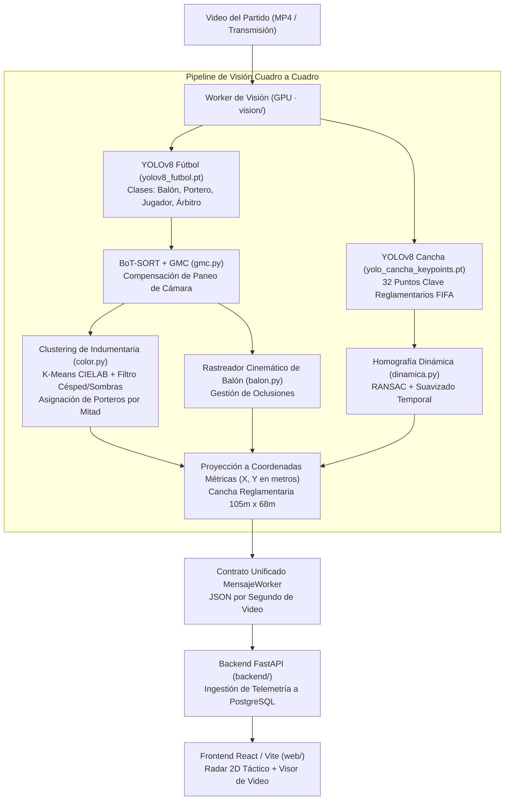

# Guía Operativa de Pruebas en Laptop con GPU · Área Técnica

Esta guía está redactada para el integrante del equipo que dispone de una laptop o PC con tarjeta gráfica **NVIDIA** (GeForce RTX 3050, 3060, 4060 o superior). 

Contiene:
1. **Qué tienes que hacer exactamente para probar el sistema con tu GPU.**
2. **Cómo actuar ante posibles problemas o errores comunes (Troubleshooting).**
3. **Cómo está estructurado técnicamente todo el sistema que construimos.**

---

## 1. ¿Qué es lo que tienes que hacer para probar? (Paso a Paso)

El sistema de visión analiza videos de partidos de fútbol reales: detecta jugadores, porteros, árbitros y el balón, rastrea sus trayectorias continuas (Track IDs), clasifica los equipos por el color de sus camisetas bajo la iluminación real del estadio, compensa los movimientos de paneo de la cámara y proyecta las posiciones a metros sobre una cancha reglamentaria 2D (105m × 68m).

Con tu GPU, el procesamiento que en CPU tarda varios minutos correrá a **30–60 FPS en tiempo real**.

---

### Paso 1.1 · Verificar los Requisitos Previos en tu Laptop
1. **Drivers NVIDIA**: Asegúrate de tener instalados los controladores actualizados de NVIDIA (GeForce Experience o desde [nvidia.com/drivers](https://www.nvidia.com/Download/index.aspx)).
2. **Python**: Versión 3.10, 3.11 o 3.12 instalada (marcar *"Add python.exe to PATH"* durante la instalación).
3. **Git**: Tener clonado el repositorio `Deportivo`.

---

### Paso 1.2 · Preparar el Entorno con PyTorch CUDA
Abre una terminal (`PowerShell` o `CMD`) en la carpeta raíz del proyecto `c:\...\Deportivo`:

```powershell
# 1. Crear el entorno virtual específico para GPU (si no existe)
python -m venv venv_gpu

# 2. Activar el entorno virtual
# En PowerShell:
.\venv_gpu\Scripts\Activate.ps1
# O en CMD tradicional:
.\venv_gpu\Scripts\activate.bat

# 3. Instalar PyTorch con aceleración CUDA 12.1 (o 11.8)
pip install torch torchvision --index-url https://download.pytorch.org/whl/cu121

# 4. Instalar las dependencias de visión y procesamiento
pip install ultralytics opencv-python numpy requests pydantic httpx
```

#### Comprobación Inmediata de CUDA:
Ejecuta este comando en la terminal activada:
```powershell
python -c "import torch; print('CUDA disponible:', torch.cuda.is_available(), '| GPU detectada:', torch.cuda.get_device_name(0) if torch.cuda.is_available() else 'NO DISPONIBLE')"
```
**Resultado esperado:**
> `CUDA disponible: True | GPU detectada: NVIDIA GeForce RTX ...`

---

### Paso 1.3 · Verificar los Modelos Neuronales
En la carpeta `vision/pesos/` deben estar presentes los dos modelos especializados que dejamos configurados:
1. `vision/pesos/yolov8_futbol.pt` *(Detector de 4 clases: balón, portero, jugador, árbitro)*.
2. `vision/pesos/yolo_cancha_keypoints.pt` *(Detector de 32 marcas y líneas reglamentarias de la cancha FIFA)*.

*(Ambos ya vienen incluidos en el repositorio).*

---

### Paso 1.4 · Elegir la Modalidad de Prueba

Tienes dos formas de hacer las pruebas:

#### Modalidad A: Solo Worker GPU (Recomendada si Daniel tiene el Backend corriendo)
No necesitas instalar PostgreSQL ni Node.js. Daniel corre el backend en su máquina y tú ejecutas el worker con tu GPU apuntando a su IP en la misma red Wi-Fi:
1. Haz doble clic en `iniciar_worker_gpu.bat`.
2. Introduce:
   - **URL de la API**: `http://IP_DE_DANIEL:8000/api` (ejemplo: `http://192.168.1.15:8000/api`).
   - **Email**: `realbetis@gmail.com`
   - **Contraseña**: `12345678`
   - **Dispositivo**: `cuda:0`

#### Modalidad B: Todo Local en tu Laptop
Si quieres correr todo el sistema (Base de datos + Backend + Frontend + Worker) en tu laptop:
1. Iniciar PostgreSQL (puerto 5432, base de datos `analisisdeportivo`).
2. Terminal 1 (Backend):
   ```powershell
   $env:PYTHONPATH="backend;vision"
   backend\venv\Scripts\python -m uvicorn app.main:app --reload --port 8000
   ```
3. Terminal 2 (Frontend Web):
   ```powershell
   npm --prefix web run dev
   ```
4. Terminal 3 (Worker GPU):
   Doble clic en `iniciar_worker_gpu.bat` (dejar URL en `http://localhost:8000/api`).

---

### Paso 1.5 · Probar el Flujo Completo en la Aplicación Web

1. Abre tu navegador en `http://localhost:5173` (o la IP donde corra el frontend).
2. Inicia sesión con:
   - **Email**: `realbetis@gmail.com`
   - **Contraseña**: `12345678`
3. Ve a la sección **Partidos** y selecciona el partido de prueba (ej. *Partido 7*).
4. **Prueba de Calibración Inteligente (F5)**:
   - Entra a **Calibración**.
   - Haz clic en el botón **«⚡ Detectar puntos con IA»**.
   - Verás cómo la red neuronal ubica instantáneamente todas las intersecciones de la cancha (córners, áreas, punto penal) y calcula el error métrico en metros automáticamente. Guarda la calibración.
5. **Prueba de Procesamiento con GPU (F2 + F3 + F4)**:
   - Ve a la pestaña **Videos**.
   - Sube un video o usa el video existente (`video-12.mp4` de Manchester City vs Tottenham).
   - Haz clic en **«Procesar video»**.
   - En la consola del worker verás cómo tu GPU toma el trabajo, procesa los fotogramas a gran velocidad y la barra de progreso avanza hasta el 100%.
6. **Prueba en el Radar 2D**:
   - Entra a **Análisis / Visor de Partido**.
   - Dale a *Play*: verás cómo los jugadores se mueven en la cancha 2D con sus coordenadas reales, sin saltos de IDs, con los colores de los equipos asignados fielmente y el balón en sincronía con el video.

---

## 2. Correcciones y Cómo Actuar ante Problemas (Troubleshooting)

### 🔴 Caso 1: PyTorch no detecta la GPU (`CUDA disponible: False`)
- **Causa**: Se instaló la versión estándar de PyTorch para CPU (la que viene por defecto en pip).
- **Cómo actuar**:
  1. Desinstalar la versión actual:
     ```powershell
     pip uninstall torch torchvision -y
     ```
  2. Forzar la instalación de la versión con soporte CUDA:
     ```powershell
     pip install torch torchvision --index-url https://download.pytorch.org/whl/cu121
     ```
  3. Revisa en el Administrador de Tareas de Windows (pestaña Rendimiento) que el driver NVIDIA esté activo.

---

### 🔴 Caso 2: `ConnectionRefusedError` al conectar el Worker
- **Causa**: La IP del backend no es alcanzable o el firewall de Windows está bloqueando el puerto 8000.
- **Cómo actuar**:
  1. Si estás en red local compartida, averigua la IP del host con `ipconfig` en la máquina del servidor (ej. `192.168.1.XX`).
  2. Asegúrate de que el backend se inició escuchando en todas las interfaces:
     `uvicorn app.main:app --host 0.0.0.0 --port 8000`
  3. Desactiva temporalmente el firewall privado de Windows o crea una regla para permitir conexiones entrantes en el puerto TCP `8000`.

---

### 🔴 Caso 3: Error de autenticación (`401 Unauthorized` o `Token inválido`)
- **Causa**: Credenciales incorrectas o usuario de otro club.
- **Cómo actuar**:
  - Utiliza siempre las credenciales predeterminadas del club de prueba:
    - **Email**: `realbetis@gmail.com`
    - **Contraseña**: `12345678`

---

### 🔴 Caso 4: Memoria de Video Llena (`CUDA Out of Memory`)
- **Causa**: Si tu GPU tiene 4 GB de VRAM (ej. RTX 3050 Laptop) y se procesa a resolución 4K nativa.
- **Cómo actuar**:
  - En la llamada del worker, especifica un tamaño de imagen escalado para inferencia (el tamaño 1280 es el estándar ideal):
    ```powershell
    python -m procesamiento.worker --dispositivo cuda:0 --tamano-img 1280
    ```

---

### 🔴 Caso 5: El video se queda en estado "En cola"
- **Causa**: El worker no estaba encendido al momento de solicitar el procesamiento o se desconectó.
- **Cómo actuar**:
  - Simplemente enciende el worker ejecutando `iniciar_worker_gpu.bat`. El worker consultará automáticamente los trabajos pendientes (`/trabajos/tomar`) y reanudará el video de inmediato.

---

### 🔴 Caso 6: Colores invertidos o confusión de camisetas
- **Causa**: Los colores configurados en el partido no corresponden con las camisetas reales que usaron en esa grabación.
- **Cómo actuar**:
  - En la vista de partido o video, ajusta el color principal (ej. Celeste `#6CABDD` y Blanco `#FFFFFF`).
  - Nuestro **Calibrador de Equipos (F4)** automáticamente aprenderá los centroides empíricos de luz del estadio en los primeros 30 cuadros del video y corregirá la asignación.

---

## 3. ¿Cómo está Estructurado Todo lo que Hicimos? (Arquitectura Técnica)

El sistema está diseñado de forma profesional siguiendo los estándares de software deportivo de alto nivel (similar a plataformas como Hudl o Second Spectrum), sin datos falsos ni simulaciones cosméticas:



---

### Descripción de los Componentes Principales

| Módulo | Archivos Clave | Responsabilidad |
|---|---|---|
| **Detección Especializada** | [`vision/deteccion/modelo.py`](file:///c:/Users/Daniel/Desktop/SW1/Deportivo/vision/deteccion/modelo.py) | Carga perezosa de Ultralytics YOLO sobre GPU CUDA. Utiliza `yolov8_futbol.pt` entrenado específicamente en fútbol para distinguir jugadores, porteros, árbitros y el balón en tomas abiertas. |
| **Seguimiento con Paneo (GMC)** | [`vision/seguimiento/tracker.py`](file:///c:/Users/Daniel/Desktop/SW1/Deportivo/vision/seguimiento/tracker.py)<br>[`vision/seguimiento/gmc.py`](file:///c:/Users/Daniel/Desktop/SW1/Deportivo/vision/seguimiento/gmc.py) | **Compensador Global de Movimiento de Cámara**: utiliza flujo óptico piramidal de alta velocidad ($< 5\text{ ms}$) para compensar los giros y paneos del operador de cámara, impidiendo que el tracker pierda el rastro de los jugadores al moverse la toma. |
| **Homografía Dinámica por IA** | [`vision/calibracion/dinamica.py`](file:///c:/Users/Daniel/Desktop/SW1/Deportivo/vision/calibracion/dinamica.py) | Detecta **32 puntos reglamentarios de la cancha** (líneas de área, punto penal, círculo central) mediante YOLOv8x-pose. Calcula la matriz de perspectiva $H$ con OpenCV RANSAC y la fusiona de forma suavizada ($\alpha = 0.35$) para proyectar píxeles a metros reales sin saltos. |
| **Clustering de Indumentaria** | [`vision/seguimiento/color.py`](file:///c:/Users/Daniel/Desktop/SW1/Deportivo/vision/seguimiento/color.py) | **`CalibradorEquiposPartido`**: en los primeros segundos del partido extrae los colores de los torsos en espacio perceptual CIELAB, descarta césped y árbitros, y agrupa en 2 clústeres empíricos ($k=2$). Asigna a los porteros según la mitad que defienden ($x < 52.5\text{ m}$) y estabiliza temporalmente los Track IDs. |
| **Seguimiento del Balón** | [`vision/seguimiento/balon.py`](file:///c:/Users/Daniel/Desktop/SW1/Deportivo/vision/seguimiento/balon.py) | Rastreador cinemático que valida velocidades físicas realistas de la pelota, ignora detecciones espurias en gradas o vallas y predice la posición cuando el balón queda tapado por el cuerpo de un jugador. |
| **Pipeline y Contrato Worker** | [`vision/procesamiento/mensajes.py`](file:///c:/Users/Daniel/Desktop/SW1/Deportivo/vision/procesamiento/mensajes.py)<br>[`vision/procesamiento/worker.py`](file:///c:/Users/Daniel/Desktop/SW1/Deportivo/vision/procesamiento/worker.py) | Ensambla las salidas de todos los módulos en el contrato JSON `MensajeWorker`, actualiza el progreso en tiempo real y gestiona la comunicación con la API del backend mediante tokens JWT de sesión. |

---

### Resumen de Comandos Rápidos para tu Terminal

```powershell
# Activar entorno
.\venv_gpu\Scripts\Activate.ps1

# Probar CUDA
python -c "import torch; print('CUDA OK:', torch.cuda.is_available())"

# Ejecutar tests para validar que todo funcione en tu entorno
$env:PYTHONPATH="vision;backend"
python -m pytest vision/tests/

# Iniciar worker
python vision/procesamiento/worker.py --api http://localhost:8000/api --email realbetis@gmail.com --password 12345678 --dispositivo cuda:0
```

Con esto, tienes todo lo necesario para ejecutar y validar el sistema al 100% en tu laptop con aceleración por tarjeta gráfica NVIDIA.

