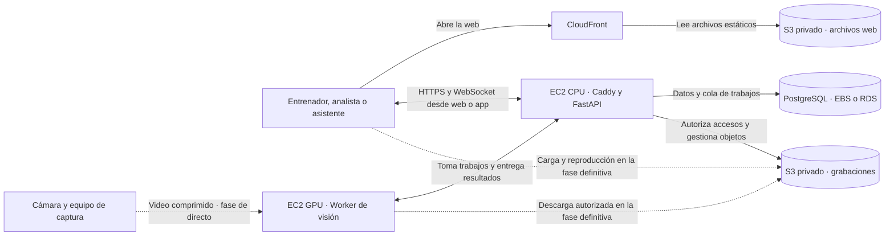

# Guía de despliegue en AWS — Área Técnica

La primera entrega en AWS puede funcionar con **CloudFront y S3 para la web, una EC2 de CPU para la API y una EC2 con GPU para el worker**. Las grabaciones tendrán su propio bucket privado de S3. Validen primero una grabación corta, después una grabación de duración real y finalmente una cámara física en directo.

## 1. Qué se despliega y dónde se usa Docker

| Pieza | Primera puesta en marcha | Docker |
|---|---|---|
| Web React/Vite | `web/dist/` en un bucket S3 privado, servido por CloudFront. | Opcional para compilar. CloudFront sirve los archivos compilados. |
| API FastAPI | Una EC2 de CPU con un proceso Uvicorn. Caddy termina HTTPS y reenvía las conexiones HTTP y WebSocket. | Sí. Reutilizar `backend/Dockerfile` y preparar un Compose de despliegue para API y Caddy. |
| PostgreSQL | Para una demo, PostgreSQL en la EC2 de CPU con disco EBS persistente y respaldo. Para un entorno de uso continuo, Amazon RDS privado. | Sí para PostgreSQL local en la EC2. RDS lo administra AWS. |
| Grabaciones | Bucket S3 privado separado del bucket de la web. | Servicio administrado. |
| Worker de visión | EC2 con GPU NVIDIA, encendida durante los ensayos o jornadas de procesamiento. | Empezar con Python en el host para comprobar CUDA. Después empaquetarlo en una imagen aparte y usar `--gpus all`. |
| Aplicación Flutter | La app instalada apunta a `https://api.<dominio>/api`. Si se quiere publicar la versión web de Flutter, compilarla y publicarla como otro sitio estático. | Opcional para compilar. |

Para la demo, **una sola réplica de la API y un solo proceso Uvicorn**. `HubMemoria` distribuye las posiciones a los WebSocket conectados dentro de ese proceso. Separar el worker de visión en otra máquina funciona porque publica por red. Agregar procesos o réplicas a la API sí requiere revisar el canal en vivo y el estado que esta conserva en memoria. Los trabajos de grabación se coordinan en PostgreSQL, así que esta primera arquitectura puede operar sin Redis ni Celery.



Las líneas punteadas representan integraciones que quedan por implementar o validar. La cámara y la GPU se conectan para el modo en directo. S3 se usa para grabaciones.

## 2. Preparar la cuenta, la red y el presupuesto

1. **Región y GPU.** Antes de contratar, comprobar desde la cuenta qué familias G están disponibles en la región y cuál es la cuota aplicada de vCPU para instancias G bajo demanda. Solicitar aumento si la cuota no permite arrancar una instancia. Colocar EC2, los buckets y RDS en la misma región inicialmente y medir el enlace desde la cancha antes de elegir la región definitiva. [Cuotas de EC2](https://docs.aws.amazon.com/AWSEC2/latest/UserGuide/ec2-on-demand-instances.html) · [Instancias GPU para Deep Learning](https://docs.aws.amazon.com/dlami/latest/devguide/gpu.html)
2. **Identidad.** Usar una cuenta con MFA y permisos de administración delegados. Dar a la EC2 de la API un rol IAM limitado al bucket y prefijos de videos y a sus secretos. El worker se autentica además ante Área Técnica con una cuenta del club. Si obtiene videos con URL firmada, su rol de AWS no necesita acceso general al bucket. [IAM y seguridad en S3](https://docs.aws.amazon.com/AmazonS3/latest/userguide/security-best-practices.html)
3. **Red.** Para la demo, asignar a la API un DNS como `api.<dominio>` y una IP estable. Publicar 443 y usar el puerto 80 para validación HTTP y redirección de Caddy. Dejar 8000 y 5432 fuera de Internet. Administrar las instancias con Session Manager si el agente, el rol y la salida a sus endpoints están configurados. Si se usa RDS, crearlo en subredes privadas y permitir 5432 únicamente desde el grupo de seguridad de la API. [Session Manager](https://docs.aws.amazon.com/systems-manager/latest/userguide/session-manager.html) · [Acceso privado a RDS](https://docs.aws.amazon.com/AmazonRDS/latest/gettingstartedguide/security-public-private.html)
4. **Costo.** Cotizar por separado las horas de CPU, las horas de GPU, los discos EBS, el almacenamiento y las solicitudes de S3, la transferencia, CloudFront, IPv4 pública y, si aplica, RDS y NAT. Configurar alertas de AWS Budgets y apagar la GPU al terminar cada sesión. Las alertas avisan del gasto y el disco EBS puede seguir generando cargos aunque la instancia esté detenida. [Calculadora de AWS](https://calculator.aws/) · [AWS Budgets](https://docs.aws.amazon.com/cost-management/latest/userguide/budgets-managing-costs.html) · [Ciclo de vida de EC2 y facturación](https://docs.aws.amazon.com/AWSEC2/latest/UserGuide/ec2-instance-lifecycle.html)

### 2.1 Buscar y elegir la instancia GPU en la consola

**1. Elegir dos regiones para comparar.** Entrar en la [consola de EC2](https://console.aws.amazon.com/ec2/) y cambiar la región arriba a la derecha. Buscar primero en la región que el equipo esté considerando para la API y el bucket. Si todavía no eligieron región, se puede comparar São Paulo (`sa-east-1`) con Norte de Virginia (`us-east-1`). Registrar disponibilidad, costo y, cuando prueben el directo, latencia desde la cancha.

**2. Buscar por nombre exacto.** En **EC2 → Tipos de instancia (Instance types)**, usar el filtro de tipo y buscar estas tres opciones por separado. Las tres usan arquitectura x86-64, una GPU, 4 vCPU y 16 GiB de RAM. La última columna es la memoria de la GPU según las especificaciones de EC2. [Especificaciones de EC2 acelerado](https://docs.aws.amazon.com/ec2/latest/instancetypes/ac.html)

| Buscar en EC2 | GPU | Memoria GPU | Cómo decidir |
|---|---|---:|---|
| `g4dn.xlarge` | NVIDIA T4 | 16 GiB | Primera candidata para un clip corto si está disponible, tiene cuota y presenta el menor costo total. |
| `g6.xlarge` | NVIDIA L4 | 22 GiB | Cotizarla para la misma prueba y compararla si necesitan mayor margen para el directo o un modelo más pesado. |
| `g5.xlarge` | NVIDIA A10G | 22 GiB | Otra candidata de una sola GPU si la cotización o la disponibilidad en esa región es mejor. |

Si un tipo aparece en el catálogo, comprobar que se ofrece en una zona de disponibilidad donde tengan una subred. Desde **AWS CloudShell**, esta consulta devuelve las zonas donde se ofrece cada tipo en la región del ejemplo. Cambiar `--region` para comparar. Una oferta en la lista indica que el tipo existe en esa zona y la capacidad al momento de lanzar se comprueba aparte. [Búsqueda de tipos EC2](https://docs.aws.amazon.com/AWSEC2/latest/UserGuide/instance-discovery.html) · [Consulta de ofertas por zona](https://docs.aws.amazon.com/cli/latest/reference/ec2/describe-instance-type-offerings.html)

```bash
aws ec2 describe-instance-type-offerings --region us-east-1 \
  --location-type availability-zone \
  --filters 'Name=instance-type,Values=g4dn.xlarge,g6.xlarge,g5.xlarge' \
  --query 'InstanceTypeOfferings[].[InstanceType,Location]' --output table
```

**3. Confirmar que su cuenta puede arrancarla.** Abrir **Service Quotas → AWS services → Amazon Elastic Compute Cloud (Amazon EC2)** en esa misma región. Buscar **Running On-Demand G and VT instances** y leer el valor aplicado a la cuenta. Para una de las tres instancias de la tabla se necesitan **4 vCPU libres de esa cuota**. Si la cuota es 0 o quedan menos de 4, solicitar el aumento desde esa pantalla. Si al lanzar sale `VcpuLimitExceeded`, revisar la cuota y el uso regional. Si sale `InsufficientInstanceCapacity`, revisar otra zona habilitada o uno de los otros tipos. [Cuotas de EC2 bajo demanda](https://docs.aws.amazon.com/AWSEC2/latest/UserGuide/ec2-on-demand-instances.html) · [Errores al lanzar EC2](https://docs.aws.amazon.com/AWSEC2/latest/UserGuide/troubleshooting-launch.html)

**4. Cotizar antes de crear.** Abrir [AWS Pricing Calculator](https://calculator.aws/) y elegir **Crear estimación → Amazon EC2 → Configurar**. Para cada opción, seleccionar la misma región, **Linux**, **Shared tenancy**, **1 instancia** y **On-Demand**. Introducir las horas reales de ensayo si el formulario permite esa carga de trabajo o anotar la tarifa por hora y multiplicarla. Por ejemplo, tres sesiones de dos horas son seis horas de cómputo. Añadir el disco `gp3` al cálculo y contemplar transferencia e IPv4 pública si corresponde. Guardar el enlace de la estimación. [Cómo cotizar EC2](https://docs.aws.amazon.com/pricing-calculator/latest/userguide/ec2-estimates.html)

**5. Configurar el lanzamiento.** Cuando el equipo haya elegido la combinación de región, tipo y costo, ir a **EC2 → Instancias → Lanzar instancias** y completar estos campos. [Lanzar una AMI de Deep Learning](https://docs.aws.amazon.com/dlami/latest/devguide/launch.html)

| Campo de la consola | Qué elegir para el primer ensayo |
|---|---|
| **Nombre** | `areatecnica-worker-gpu-prueba` |
| **Imagen (AMI)** | Buscar `Deep Learning` y `Ubuntu 24.04`. Elegir una AMI oficial de AWS para x86-64 con controlador NVIDIA y comprobar que admite el tipo elegido. Registrar el ID de AMI. |
| **Tipo de instancia** | El tipo cotizado, por ejemplo `g4dn.xlarge`. Elegir bajo demanda para esta primera prueba. |
| **Red, subred y grupo de seguridad** | Subred en una zona que ofrezca el tipo y con salida HTTPS a la API y a los servicios requeridos. Para grabaciones el worker inicia las conexiones. Puede arrancar sin puertos públicos de entrada si se administra con Session Manager. |
| **Perfil IAM** | El perfil de la instancia que permite Session Manager. Otorgar acceso a secretos o pesos privados solo si el ensayo los necesita. |
| **Almacenamiento** | EBS `gp3` cifrado. Para un ensayo con clips cortos, cotizar 60 GiB como punto de partida y verificar el mínimo de la AMI. Dejar espacio para el sistema, CUDA, modelos y copia temporal del video. |

**6. Validar y registrar el resultado.** En **EC2 → Instancias → Conectar → Session Manager**, abrir una sesión y ejecutar `nvidia-smi`. Continuar con la [prueba del worker](#6-ejecutar-el-worker-de-visión-en-ec2-con-gpu) para confirmar que PyTorch usa CUDA y que el clip termina en estado `PROCESADO`. Anotar cuánto tarda con el mismo clip y configuración si comparan dos instancias. Detener la instancia al terminar el ensayo. [Requisitos de Session Manager](https://docs.aws.amazon.com/systems-manager/latest/userguide/session-manager-prerequisites.html)

Para compartir la cotización con el equipo basta con registrar **región y zona, tipo de instancia, cuota disponible, precio por hora, horas estimadas, costo de disco y enlace de la estimación**. Si también va a buscar la EC2 del backend, repetir el mismo flujo con `t3.medium` y `t3a.medium` como candidatas de CPU para la demo con PostgreSQL. Para S3, CloudFront y RDS, agregar sus propios servicios en la calculadora. [Especificaciones de EC2 de uso general](https://docs.aws.amazon.com/ec2/latest/instancetypes/gp.html)

## 3. Desplegar la API y la base de datos

1. Instalar Docker Engine y Compose v2 en la EC2 de CPU. Para la primera demo, copiar una revisión identificable del código y construir la imagen en esa máquina. Para despliegues repetibles, publicar una imagen etiquetada en ECR y conservar la etiqueta anterior para poder volver a desplegarla. [Registro privado de Amazon ECR](https://docs.aws.amazon.com/AmazonECR/latest/userguide/docker-push-ecr-image.html)
2. Preparar `compose.deploy.yml`. Usar `backend/` como contexto de compilación y su `Dockerfile`. Añadir Caddy con puertos públicos 80 y 443 y un volumen persistente para sus certificados. Añadir PostgreSQL si la demo lo aloja en la misma EC2. Montar sus datos en EBS y dejar el puerto 5432 solo en la red interna de Compose. Para RDS, configurar TLS con verificación del certificado y del nombre del servidor usando la CA de AWS. [Caddy y HTTPS](https://caddyserver.com/docs/automatic-https) · [Proxy de Caddy y WebSocket](https://caddyserver.com/docs/caddyfile/directives/reverse_proxy) · [TLS en RDS PostgreSQL](https://docs.aws.amazon.com/AmazonRDS/latest/UserGuide/PostgreSQL.Concepts.General.SSL.html)

   ```caddyfile
   api.example.com {
       reverse_proxy api:8000
   }
   ```
3. Configurar las variables de la API. Usar secretos distintos por ambiente y suministrar credenciales al contenedor desde un archivo restringido en la demo o desde un gestor de secretos al automatizar el despliegue.

   | Variable | Valor o propósito |
   |---|---|
   | `DATABASE_URL` | `postgresql+asyncpg://...` al servicio interno de Compose o a RDS. Configurar TLS verificado para RDS. |
   | `SECRET_KEY` | Valor aleatorio de producción, estable entre reinicios. |
   | `CORS_ORIGINS` | URL exacta de la web publicada y la de Flutter web si se publica. |
   | `WEB_URL` | URL de la web para los enlaces de recuperación de contraseña. |
   | `VIDEOS_DIR` | `/app/almacen/videos`. Montar `/app/almacen` completo en EBS durante la primera fase, ya que también contiene las muestras de reproducción. |
   | `APP_ENV` / `SEED_DEMO_DATA` | `production` / `false`. Crear cuentas controladas para la prueba. |
   | `VISION_AUTO_WORKER` | `false`. La máquina con GPU toma los trabajos. |
   | `SMTP_*` | Configurar un servicio de correo si van a habilitar recuperación de contraseña en la nube. |

4. Iniciar PostgreSQL, esperar a que acepte conexiones y ejecutar la migración una vez desde el contenedor de la API. Levantar el API y Caddy. Ejemplo con el Compose de despliegue ya preparado y PostgreSQL dentro de la EC2:

   ```bash
   docker compose -f compose.deploy.yml up -d db
   docker compose -f compose.deploy.yml run --rm api alembic upgrade head
   docker compose -f compose.deploy.yml up -d api caddy
   curl --fail https://api.example.com/api/salud
   ```

   Con RDS, empezar por la migración cuando la conexión ya esté disponible. Confirmar `/api/salud` y luego iniciar sesión, crear un partido de prueba y abrir el canal en vivo. La ruta de salud por sí sola no verifica PostgreSQL ni WebSocket. Hacer respaldo de PostgreSQL y del volumen de muestras antes de actualizar. Una reversión de la imagen puede requerir restaurar la base si la migración es incompatible.

## 4. Publicar la web

1. Crear un bucket S3 privado para los archivos estáticos y conectarlo a una distribución CloudFront con **Origin Access Control**. Mantener el bloqueo de acceso público del bucket. Usar el dominio de la distribución para ensayar o configurar `app.<dominio>` con un certificado ACM en `us-east-1` para CloudFront. [S3 privado con CloudFront OAC](https://docs.aws.amazon.com/AmazonCloudFront/latest/DeveloperGuide/private-content-restricting-access-to-s3.html) · [Certificados para CloudFront](https://docs.aws.amazon.com/AmazonCloudFront/latest/DeveloperGuide/cnames-and-https-requirements.html)
2. Compilar en `web/` con `VITE_API_URL=https://api.<dominio>/api` y `VITE_USE_MOCKS=false`. Vite incorpora estos valores al compilar. Ejemplo en Bash desde la raíz del repositorio:

   ```bash
   (cd web && npm ci && VITE_API_URL=https://api.example.com/api VITE_USE_MOCKS=false npm run build)
   aws s3 sync web/dist/ s3://NOMBRE_BUCKET_WEB/ --exclude 'index.html'
   aws s3 cp web/dist/index.html s3://NOMBRE_BUCKET_WEB/index.html --cache-control 'no-cache'
   ```

3. Establecer `index.html` como documento de inicio y reescribir las rutas de la aplicación a `/index.html`, conservando las rutas de archivos estáticos. Usar TTL mínimo cero para el HTML si se respeta su `Cache-Control`. Después de actualizar, comprobar que CloudFront sirve el nuevo HTML e invalidarlo si corresponde. Probar recarga directa de una ruta, inicio de sesión y conexión `wss://` de un partido. [Guía de AWS para aplicaciones SPA con CloudFront](https://docs.aws.amazon.com/solutions/improved-single-page-application-performance-using-amazon-cloudfront/)
4. Para publicar también Flutter web, ejecutar `flutter build web --release --dart-define=ENTORNO=prod --dart-define=API_URL=https://api.example.com/api` desde `movil/`. Publicar `movil/build/web/` como un sitio independiente y registrar su origen en `CORS_ORIGINS`. Los builds nativos de Flutter usan las mismas variables.

## 5. Mover las grabaciones a S3

**Estado del código.** La API recibe los fragmentos del video, los escribe en disco y entrega el archivo al worker mediante `GET /api/vision/videos/{id}/archivo`. El visor web también descarga la grabación completa como `Blob` antes de reproducirla. Crear el bucket no cambia ese flujo. En la primera prueba de AWS, el disco EBS permite comprobar el sistema con el código actual y un clip corto.

**Integración prevista para videos largos.** El navegador sube por partes a S3, la API conserva el control de acceso y el worker recibe un enlace temporal tras tomar un trabajo:

1. **Carga.** Conservar en PostgreSQL el registro del video, el club, su clave de objeto y el estado de carga. La API valida el tamaño y el acceso al partido, inicia una carga multiparte de S3 y firma URLs por parte. El navegador sube cada fragmento, registra sus ETag y completa o reanuda la carga a través de la API. La API verifica tamaño e integridad al terminar y conserva la validación de metadatos de video antes de habilitar el procesamiento. Configurar CORS para el dominio web y exponer `ETag`. Abortar cargas multiparte abandonadas con una regla de ciclo de vida. [Carga multiparte en S3](https://docs.aws.amazon.com/AmazonS3/latest/userguide/mpuoverview.html)
2. **Reproducción.** Tras comprobar que el usuario pertenece al club, la API entrega una URL GET firmada y de vigencia limitada. Usarla como `src` del reproductor para que el navegador empiece a reproducir sin descargar todo el archivo y pueda pedir rangos al adelantar. Prever la renovación del enlace para sesiones largas y comprobar `Range` en el navegador. Para la primera prueba usar MP4 con H.264 y medir aparte la compatibilidad de las grabaciones que aceptará la aplicación. [URLs firmadas en S3](https://docs.aws.amazon.com/AmazonS3/latest/userguide/using-presigned-url.html) · [Lecturas por rango](https://docs.aws.amazon.com/AmazonS3/latest/userguide/optimizing-performance-guidelines.html)
3. **Worker.** Mantener el contrato de toma de trabajos y entrega de resultados por API. Al cambiar la descarga, obtener una URL GET firmada para el objeto autorizado y descargarla con un cliente separado del cliente autenticado de la API. Este último adjunta el JWT de Área Técnica a las solicitudes, por lo que reutilizarlo directamente para S3 podría enviar el token al destino equivocado. Preparar renovación del enlace y reanudación parcial si se corta la conexión.
4. **Datos existentes.** Mantener el almacén en disco como alternativa durante la migración. Pasar los videos existentes a S3 por clave, verificar la copia y registrar dónde se encuentra cada video antes de cambiar su lectura. Respaldar y mantener accesibles las muestras JSON de análisis. Actualmente son archivos aparte y harán falta un almacén compartido o una migración a base de datos si se quiere sustituir la EC2 sin depender de su volumen.

## 6. Ejecutar el worker de visión en EC2 con GPU

1. Elegir una EC2 con GPU NVIDIA bajo demanda y una imagen de Linux con controlador compatible. Instalar Python, PyTorch con CUDA y `vision/requirements.txt`. Verificar la GPU en PyTorch. Preparar espacio temporal para la grabación y los modelos. Instalar los pesos de detección elegidos y el modelo de cancha con `python -m calibracion.instalar_modelo` desde `vision/`. Registrar origen, versión y hash de los pesos que use la prueba. [Instancias y AMI de AWS para GPU](https://docs.aws.amazon.com/dlami/latest/devguide/gpu.html)
2. En la web, usar un partido nuevo, cargar un clip, configurar la calibración para ese video y encolar el procesamiento. En la EC2 GPU, desde `vision/`, apuntar al dominio real de la API. `--una-vez` termina si todavía no hay un trabajo disponible.

   ```bash
   nvidia-smi
   python -c "import torch; print(torch.cuda.is_available()); print(torch.cuda.get_device_name(0) if torch.cuda.is_available() else 'SIN CUDA')"
   python -m procesamiento.worker --api https://api.example.com/api \
     --email analista@example.com --dispositivo cuda:0 --clases coco --una-vez
   ```

   La contraseña se solicita al ejecutar el comando. Para una ejecución desatendida, suministrar `VISION_PASSWORD` desde un secreto. Confirmar en logs que el dispositivo efectivo es `cuda:0`, porque el worker puede continuar en CPU si CUDA no está disponible. Para operar continuamente durante la jornada, ejecutar el worker sin `--una-vez` como servicio con reinicio controlado y logs. El modo grabado actual descarga por HTTPS desde la API y funciona aunque S3 todavía no esté integrado.
3. Cuando la ejecución nativa esté medida, construir un **Dockerfile propio de `vision/`** con versiones fijadas de Python, Torch y CUDA. Instalar NVIDIA Container Toolkit en el host y repetir la prueba de CUDA desde el contenedor con `--gpus all`. Montar o descargar los pesos versionados y utilizar un volumen para archivos temporales si hace falta. [Comprobación de GPU en Docker con NVIDIA](https://docs.nvidia.com/datacenter/cloud-native/container-toolkit/latest/sample-workload.html)
4. **Directo.** Usar otro partido, configurar `camara-principal` con calibración automática e iniciar el encuentro en la web. Probar primero `procesamiento.directo` con `--simular-directo` y un clip accesible en EC2. Para la cámara física, usar un equipo en cancha que capture y envíe el video comprimido por una conexión autenticada al worker. Medir ancho de banda, pérdida de conexión y latencia desde cámara hasta pantalla. La vista previa del navegador actual no envía el video a la GPU. El worker devuelve posiciones por WSS, así que mostrar también la imagen remota en la web exigiría un flujo de reproducción separado. [Guía actual del worker remoto](../GUIA_PRUEBAS_LAPTOP_GPU.md)

   ```bash
   python -m procesamiento.directo --api https://api.example.com/api \
     --email analista@example.com --partido 123 --fuente /ruta/al/clip.mp4 \
     --fuente-id camara-principal --simular-directo --dispositivo cuda:0 --clases coco
   ```

## 7. Orden de trabajo y criterios de entrega

| Fase | Qué debe quedar comprobado |
|---|---|
| 1. Web, API y PostgreSQL | HTTPS, login, creación de partido, recarga de rutas de la web, datos persistentes y canal WebSocket. |
| 2. Grabación corta con EC2 GPU | La API encola el clip, la GPU lo procesa, el estado llega a `PROCESADO` y el visor muestra posiciones y video sincronizados. |
| 3. S3 y grabación larga | Carga multiparte, reanudación, reproducción por rangos, descarga desde el worker y rechazo de acceso desde otro club. El bucket permanece privado. |
| 4. Directo desde cancha | Transporte con cámara física, reconexión, latencia de extremo a extremo y una sesión de duración de partido. Registrar costo y calidad de las detecciones. |

Asignar responsables a tres frentes que pueden avanzar en paralelo después de acordar el dominio y el contrato entre la API y el worker. Infraestructura prepara EC2, CloudFront y PostgreSQL. Backend y web integran S3. Visión valida CUDA, calibra y mide el directo. La infraestructura propuesta y los ejemplos de esta guía quedan pendientes de ejecución en una cuenta de AWS.
